<p align="center">
  <picture>
    <source media="(prefers-color-scheme: dark)" srcset="design/logo/addiem-lockup-dark.svg">
    
  </picture>
</p>

<p align="center"><b>Anki가 복습 시점을 관리한다면, Addiem은 시험일까지의 완주 전략을 관리해요.</b></p>

<p align="center">
  <a href="https://github.com/itisyijy/Addiem/releases/latest"></a>
  
  
  <a href="LICENSE"></a>
</p>

<p align="center">한국어 · <a href="README.en.md">English</a></p>

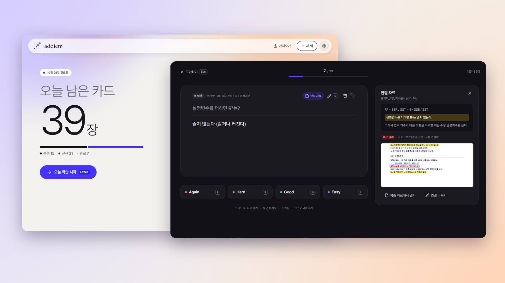

**Addiem**(에디엠)은 시험 목표와 카드 품질을 함께 관리해, 정해진 기간 안에 핵심 내용부터 외우도록 돕는 Anki 호환 학습 앱이에요. 이름은 라틴어 *ad diem*, '그날까지'에서 왔어요. 로고의 대각선은 날짜 칸을 지나 주황 점, 곧 시험일에 닿아요.

**[설치 파일 내려받기](https://github.com/itisyijy/Addiem/releases/latest)** · [설치](#설치) · [시작하기](#시작하기) · [데이터와 개인정보](#데이터와-개인정보) · [알려진 제한](#알려진-제한)

## 소개

- **쓰던 Anki 덱을 이어서 써요.** `.apkg` · `.colpkg`를 가져오고, 복습 기록도 함께 옮길 수 있어요. 새 덱을 만들어 바로 시작해도 돼요.
- **덱마다 시험일과 중요도를 정해요.** 남은 날짜와 핵심 · 일반 · 보충 중요도에 맞춰 오늘 볼 카드를 골라 줘요. 복습 간격은 FSRS로 계산해요.
- **강의 자료와 카드를 이어요.** PDF · PPTX의 강조와 목차를 읽어, 카드가 어디서 나왔는지 학습 중에 바로 열어 볼 수 있어요.
- **이 기기에 저장해요.** 계정이 없어도 되고, 학습 · 가져오기 · 카드 점검은 인터넷 없이 돼요. Google Drive 동기화와 ChatGPT 연결은 켜고 싶을 때만 켜요.
- **바꾸기 전에 보여 줘요.** 중요도 제안 · 서식 고치기 · 덱 업데이트는 바뀌는 것을 먼저 보여 주고, 확정은 직접 해요. 고친 것은 되돌릴 수 있어요.

## 주요 기능

### 학습

홈에서 오늘 남은 카드(복습 · 신규)와 덱별 분량을 보고 [오늘 학습 시작]을 누르면 돼요. 평가는 Again · Hard · Good · Easy 네 가지이고, 키보드만으로도 한 번의 학습을 끝낼 수 있어요(단축키는 설정에서 바꿔요).

- 같은 학습에서 Again을 두 번 받은 카드는 잠깐 접어 두고 나머지를 먼저 봐요. 어려운 카드 하나가 오늘 진도를 막지 않아요.
- 앱 기본 노트 유형: 질문과 답변 · 양방향 · 빈칸 · 서술형 · 목록 · 선택형 · 그림 가리기. 소리 재생, Anki `{{tts}}` 읽어주기, 수식(KaTeX)도 돼요.
- 화면 테마는 밝게 · 어둡게 · 시스템 따름 중에서 골라요. Windows 고대비 테마에서도 로고와 글자가 시스템 색으로 보여요.

<p>
  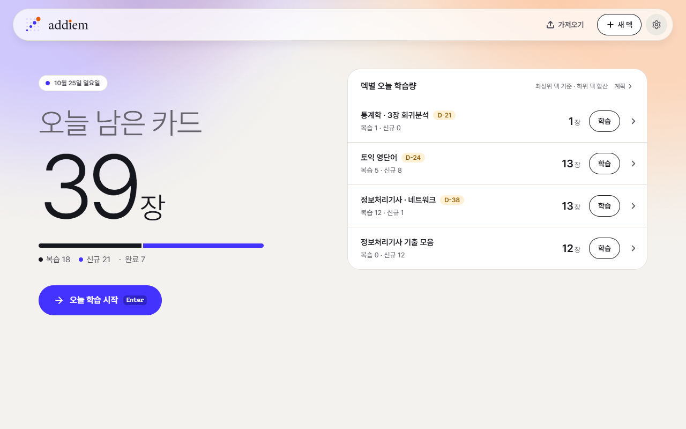
  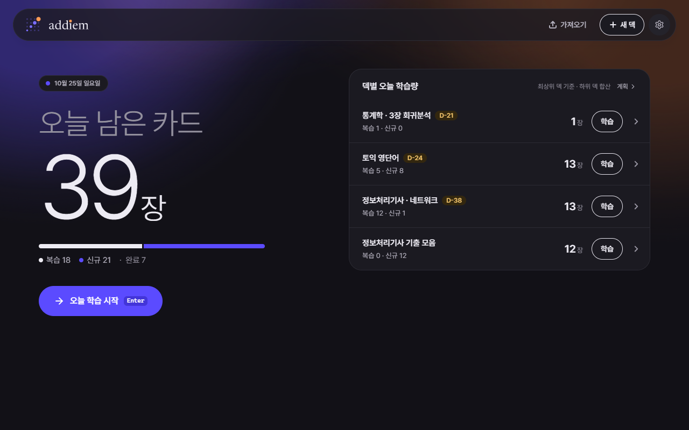
</p>

### 계획과 시험

덱에 시험일을 정하면 남은 신규 카드를 남은 날로 나눠 하루 분량을 정해요(예: 남은 신규 186장 ÷ 24일 = 하루 8장). 계산식과 진행률을 숨기지 않고 보여 줘요.

- 학습 계획: 날짜별 복습 · 신규 예상, 실제 속도에 맞춰 매일 다시 나누기, 평일 · 주말 공부 시간, 여러 덱의 시험일이 겹칠 때 조정.
- 시험 전 회독(시험 14일 전부터): 핵심 · 약한 챕터 · 불안한 카드만 빠르게 도는 **압축**, 범위 전체를 돌며 약한 카드를 끼워 넣는 **혼합** 중에서 골라요.
- 기출 표시: 카드나 자료 구간에 어느 시험에 나왔는지 달아 두면, 같은 중요도 안에서 기출 카드를 먼저 배워요.

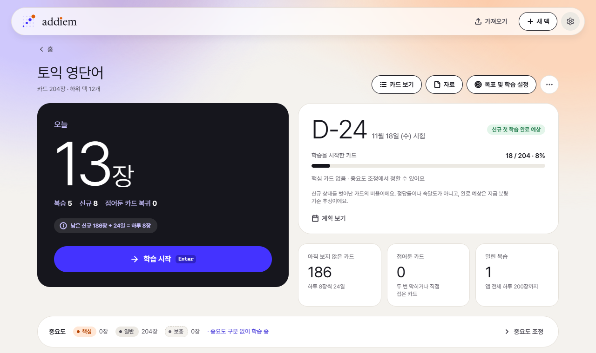

### 원자료와 중요도

강의 PDF · PPTX를 덱에 넣으면 하이라이트 · 밑줄 · 붉은 글씨 · 굵은 글씨 · ★ 표시를 **강조 구간**으로, 제목 구조를 **목차**로 읽어요. 제목에 '요약' · '핵심' 같은 낱말이 있거나 제목이 하이라이트 · 밑줄 · 붉은 글씨 · ★로 강조된 구간은 **핵심 범위**로 제안해요(제안이에요. 확정은 중요도 정하기에서 해요).

- 강조 구간을 카드와 이으면, 학습 중 [연결 자료] 버튼(단축키 S)으로 그 쪽을 바로 열어 봐요.
- 카드가 이어지지 않은 강조 구간(미연결 강조 구간)을 모아 보여 줘서 빠뜨린 범위를 찾기 쉬워요.
- PDF의 그림 · 표 영역을 잡아 그림 카드나 그림 가리기 카드로 만들 수 있어요.

<p>
  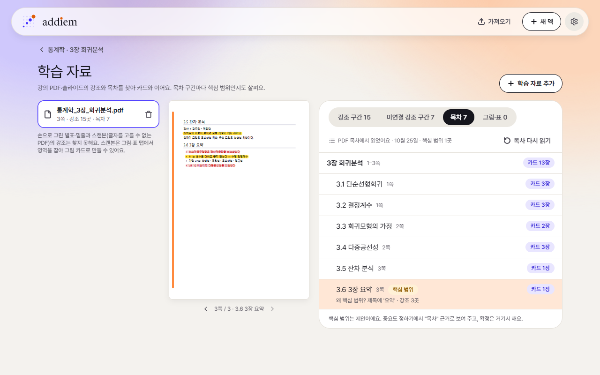
  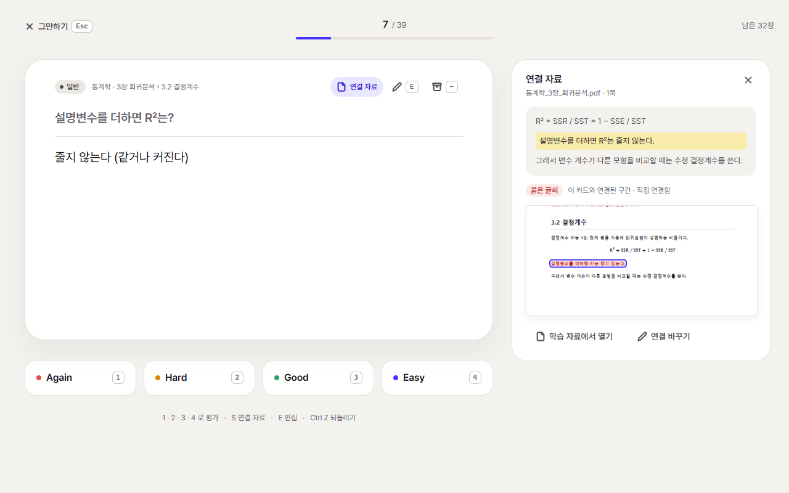
</p>

중요도는 카드가 아니라 하위 덱 단위로 정해요. 가져온 태그(예: `중요도::최우선`), 하위 덱 이름(예: '요약' · '부록'), 자료 · 기출 표시를 근거로 초기 배치를 제안하고, 칩에 마우스를 올리면 이유를 한 줄로 보여 줘요. 직접 확정한 값은 자동 제안이 덮어쓰지 않아요.

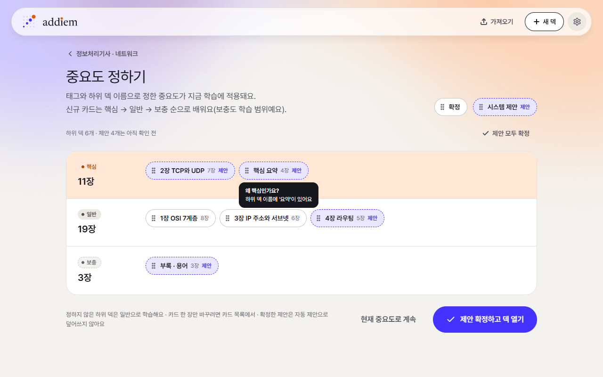

### Anki 호환과 덱 업데이트

- 가져오기: Anki `.apkg` · `.colpkg`(덱 구조 · 노트 유형 · 태그 · 미디어 · 복습 기록), JSON, CSV. 처리하지 못한 항목은 조용히 버리지 않고 결과 화면에 알려 줘요. 원본 파일은 읽기만 해요.
- 내보내기: 덱을 `.apkg`(복습 기록 포함 여부 선택)나 CSV로 내보내요.
- **덱 업데이트:** 이미 가져온 덱의 새 버전 파일을 받으면 [업데이트로 가져오기]를 권해요. 만든 사람이 고친 노트는 새 버전으로 바꾸고, 내가 고친 필드와 복습 기록 · 일정은 지켜요. 같은 필드를 둘 다 고친 충돌은 나란히 보고 골라요. 적용 전에 백업을 만들고, 나중에 이 업데이트만 되돌릴 수도 있어요.

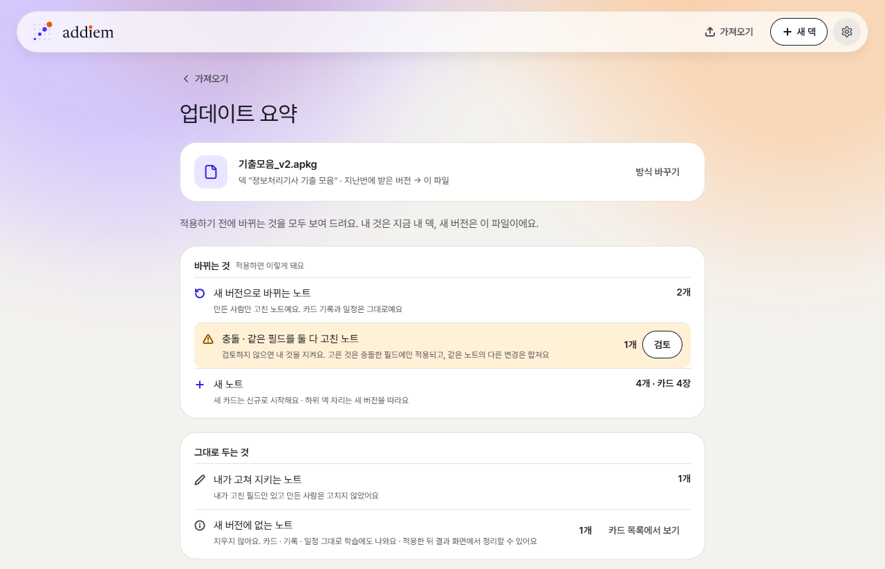

JSON으로 카드를 만들 때는 [JSON 일괄 가져오기 형식](docs/engineering/json-import-format.md)을 보세요.

### 카드 품질

계속 틀리는 이유가 기억이 아니라 카드 모양일 때가 있어요. 카드 점검은 규칙으로 이런 카드를 찾아요(기기 안에서 바로).

- 답이 너무 긴 카드, 질문이 여러 개인 카드 → [나누기 제안]. 최근 14일에 Again을 2번 이상 받은 긴 카드는 따로 모아 보여 줘요
- 질문과 답이 안 맞아 보이는 카드(예: "차이"를 묻는데 답이 낱말 하나) → 이유 한 줄과 함께 표시
- 한 줄에 이어 쓴 번호 · 항목 → [서식 고치기]: 글자는 그대로 두고 줄바꿈 · 굵게 · 항목 사이 쉼표만 바꿔요

고치기 전에 지금 카드와 고친 카드를 나란히 보여 주고, 고친 뒤 7일 동안 되돌릴 수 있어요.

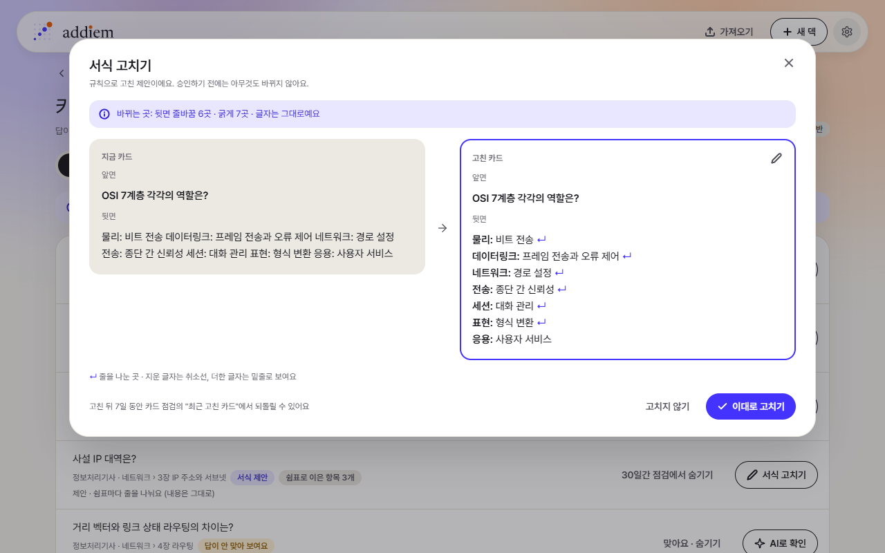

### 서술형 채점

서술형 카드는 답을 직접 써 보고 [답과 비교하기]를 눌러요. 등록한 핵심어가 내 답에 있는지 표시하고, 핵심어 기준으로 평가를 추천해요. 최종 평가는 직접 골라요.

- **개념 관계 확인 (실험 기능):** 설정 › 서술형 채점에서 모델(약 1.1GB)을 받으면, 모범 답안의 관계(원인 → 결과 등)를 내 답에서 찾아 '맞아 보여요 · 안 보여요'처럼 보여 줘요. 이 기기 안에서만 돌고, 참고용이라 틀릴 수 있어서 평가 추천에는 쓰지 않아요. AVX2를 지원하는 CPU에서만 쓸 수 있어요.
- ChatGPT를 연결했다면 [ChatGPT로 채점 보조]로 의미를 한 번 더 확인할 수 있어요.

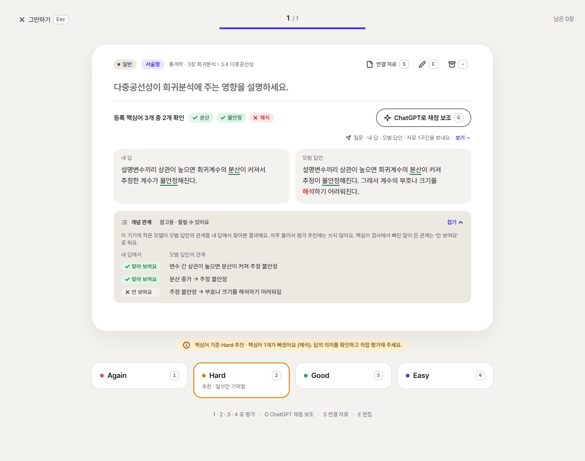

### 노트 유형

카드를 만드는 틀(노트 유형)을 직접 만들고 고쳐요. **쉬운 편집**에서는 필드를 끌어 앞면 · 뒷면에 놓고 크기 · 정렬을 고르고, 실제 노트로 미리보기를 봐요. HTML · CSS를 직접 고치려면 **HTML** 탭을 써요. 카드 종류(예: 단어 → 뜻, 뜻 → 단어)를 더하면 노트 하나에서 카드가 한 장씩 더 생겨요.

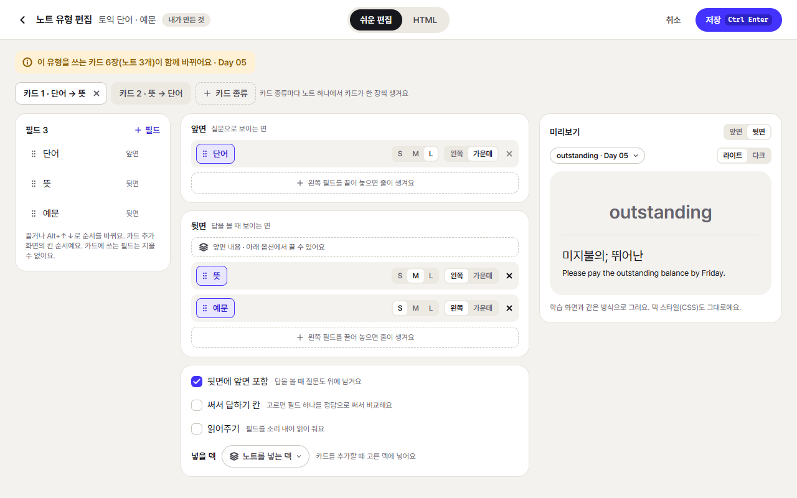

### Google Drive 동기화

내 Google Drive에 자동으로 백업하고, 다른 컴퓨터에서도 같은 덱 · 카드 · 복습 기록으로 이어서 공부해요. Addiem 서버를 거치지 않아요.

- 권한은 두 가지뿐이에요: Addiem이 만든 파일만(`drive.file`), 앱 전용 폴더(`drive.appdata`). 내 Drive의 다른 파일은 보지 않아요.
- [암호로 잠그기]를 켜면 이 기기에서 암호화한 뒤 올려서 Google도 내용을 볼 수 없어요. 암호를 잊으면 Drive에 올린 데이터는 열 수 없어요(이 기기 데이터는 남아요).
- 연결을 끊어도 이 기기 데이터는 그대로예요. Drive 없이 쓸 때는 설정 › 이 기기 백업에서 백업 파일을 만들고 복구해요.

### 선택 AI (ChatGPT)

ChatGPT 계정으로 연결하면 자료에서 카드 초안 만들기, 서술형 채점 보조, 비슷한 내용끼리 나누기, 선택형 오답 보기 제안, 카드 점검의 질문 · 답 확인을 쓸 수 있어요. 내 ChatGPT 요금제를 쓰고, Addiem에는 추가 요금이 없어요. 버튼을 직접 누를 때만 요청을 보내요. 연결하지 않아도 나머지 기능은 쓸 수 있어요.

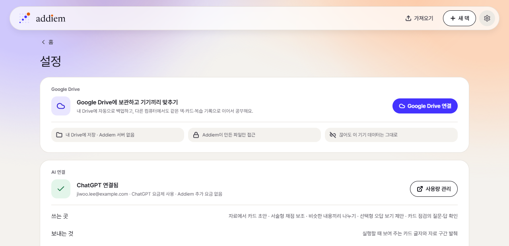

## 설치

**필요한 것**

- Windows 10 · 11 (64비트)
- Microsoft Edge WebView2 런타임. Windows 11에는 들어 있어요. 없으면 설치 중에 내려받아요(인터넷 필요).

**설치 파일:** [Releases](https://github.com/itisyijy/Addiem/releases/latest)에서 `Addiem_0.1.0_x64-setup.exe`를 내려받아요. 같은 곳에 있는 `SHA256SUMS.txt`로 파일이 온전한지 확인할 수 있어요.

```powershell
Get-FileHash .\Addiem_0.1.0_x64-setup.exe -Algorithm SHA256
```

1. 설치 파일을 실행해요. 관리자 권한 없이 지금 사용자 계정에 설치돼요(`%LOCALAPPDATA%\Addiem`). 설치 화면은 Windows 표시 언어에 따라 한국어 또는 영어로 보여요.
2. 아직 코드 서명이 없어서 "Windows의 PC 보호" 파란 창이 뜰 수 있어요. [추가 정보] → [실행]을 눌러요.
3. 시작 메뉴에서 Addiem을 열어요.

- **Neo-Anki를 쓰던 경우:** Addiem의 예전 이름이 Neo-Anki예요. Addiem을 설치하면 예전 Neo-Anki 프로그램을 먼저 지우고(학습 데이터는 그대로), 같은 데이터로 이어서 열려요. 백업 폴더 · 파일 이름의 `neoanki`와 Drive의 "Neo-Anki 백업" 폴더는 데이터를 잇기 위해 예전 이름 그대로 써요.
- **업데이트:** 자동 업데이트는 없어요. 새 버전 설치 파일로 다시 설치해요. 학습 데이터는 지워지지 않아요. 지금 버전은 설정 화면 맨 아래에 보여요.
- **지우기:** Windows 설정 › 앱에서 Addiem을 제거해요. 학습 데이터는 남아요. 데이터까지 지우려면 제거 창에서 [애플리케이션 데이터 삭제하기]를 체크해요.
- 백신(Microsoft Defender 등)이 개념 관계 확인 엔진(`llm\neoanki-llm.exe`)을 막거나 지우면 그 기능만 꺼지고(설정 › 서술형 채점에 "이 설치에는 개념 관계 확인 엔진이 없어 쓸 수 없어요"), 핵심어 채점과 나머지 기능은 계속 쓸 수 있어요.

## 시작하기

1. 처음 화면에서 [새 덱 만들기]로 이름만 정해 덱을 만들거나, [가져오기]로 쓰던 Anki 덱(`.apkg` · `.colpkg`)이나 JSON · CSV 파일을 가져와요.
2. 덱 화면의 [목표 및 학습 설정]에서 시험일을 정해요. 정하지 않으면 시험일 없는 덱으로 계속 복습해요.
3. [중요도 조정]에서 제안된 핵심 · 일반 · 보충 배치를 확인하고, 틀린 것만 옮겨요. 건너뛰어도 학습은 돼요.
4. 강의 PDF · PPTX가 있으면 덱 화면의 [자료]에서 추가해요.
5. 홈에서 [오늘 학습 시작]을 누르거나 Enter 키를 눌러요.

## 데이터와 개인정보

- 덱 · 카드 · 복습 기록 · 미디어 · 추가한 자료는 이 기기에 저장돼요(`%APPDATA%\io.github.itisyijy.neoanki`). Addiem 서버는 없어요.
- 인터넷은 아래 경우에만 써요. 모두 직접 켜거나 눌렀을 때예요.
  - **Google Drive 동기화:** 덱 · 카드 · 복습 기록 · 설정과 그림 · 미디어를 올려요. `drive.file` · `drive.appdata` 권한만 쓰고, 원자료 파일(PDF · PPTX)과 모델 파일은 올리지 않아요.
  - **ChatGPT (선택 AI):** 그때 화면에 보여 준 카드 글자와 자료 구간 발췌만 OpenAI로 보내요. 원자료 파일 전체 · 그림 · 복습 기록 · 덱 이름은 보내지 않아요.
  - **모델 내려받기:** 분석 모델(multilingual-e5-small, 약 490MB, 비슷한 카드 찾기 · 자료와 카드 자동 연결)과 개념 관계 확인 모델(Qwen2.5-1.5B-Instruct 4비트, 약 1.1GB)은 [내려받기]를 누를 때만 Hugging Face에서 받아요. 파일마다 크기와 SHA-256을 확인하고, 받은 뒤에는 이 기기 안에서만 돌아요.
- Google · ChatGPT 로그인 정보와 동기화 잠금 키는 Windows 자격 증명 관리자에만 저장해요.
- 읽어주기는 이 기기 안의 음성으로 읽어요.

## 알려진 제한

- **코드 서명이 없어요.** 설치 파일과 앱을 처음 열 때 SmartScreen 경고가 떠요(위 [설치](#설치) 참고).
- **Windows만 지원해요.** macOS · Linux · 모바일 앱은 없어요.
- **자동 업데이트가 없어요.** 새 버전은 설치 파일을 다시 받아 설치해요.
- **Google 로그인은 아직 등록한 테스트 사용자만 돼요.** Google OAuth 동의 화면을 공개로 게시하기 전까지는 Drive 동기화를 쓸 수 있는 계정이 정해져 있어요.
- **개념 관계 확인은 실험 기능이에요.** 참고용이고 틀릴 수 있어요. 약 1.1GB를 따로 받아야 하고, AVX2를 지원하는 CPU(FMA · F16C 포함)에서만 돌아요.
- Anki 애드온은 지원하지 않고, 카드 템플릿의 스크립트(JavaScript)는 실행하지 않아요. 그런 카드가 있으면 가져오기 결과에 알려 줘요.
- AnkiWeb과 직접 동기화하지 않아요. Anki와는 `.apkg` 파일로 주고받아요.

## 자주 묻는 질문

**Anki와 같이 써도 되나요?**
돼요. Addiem은 Anki 파일을 읽기만 하고 고치지 않아요. 덱을 `.apkg`로 내보내 Anki로 다시 가져갈 수도 있어요. 다만 두 앱의 복습 기록은 자동으로 합쳐지지 않으니, 한 덱은 한쪽에서 공부하는 걸 권해요.

**시험일이 지나면 어떻게 되나요?**
시험일 없는 덱처럼 FSRS 간격대로 계속 복습해요. 새 시험일을 정하면 그날에 맞춰 다시 나눠요.

**데이터를 다른 컴퓨터로 옮기려면요?**
Google Drive 동기화를 켜거나, 설정 › 이 기기 백업에서 만든 백업 파일을 다른 컴퓨터에서 [백업으로 복구]해요.

## 문서

- [제품 방향](docs/product/product-direction.md) · [MVP 범위](docs/product/mvp-scope.md) · [MVP 화면 흐름](docs/product/mvp-screen-flow.md)
- [JSON 일괄 가져오기 형식](docs/engineering/json-import-format.md)
- [덱 업데이트](docs/engineering/deck-update.md) · [노트 유형](docs/engineering/note-types.md) · [Google Drive 동기화 설계](docs/engineering/drive-sync.md)
- [UI 문구 기준](docs/design/copy-guide.md) · [로고와 브랜드](design/logo/README.md)
- [개발 문서](docs/engineering/development.md) — 빌드 · 실행 · 확인 · 배포 체크리스트 · 구조 · 도구

## 함께 쓴 오픈소스

[Tauri](https://tauri.app) · [React](https://react.dev) · [FSRS](https://github.com/open-spaced-repetition/fsrs-rs) (BSD-3-Clause) · [KaTeX](https://katex.org) (MIT) · [PDF.js](https://mozilla.github.io/pdf.js/) (Apache-2.0) · [DOMPurify](https://github.com/cure53/DOMPurify) · [Pretendard](https://github.com/orioncactus/pretendard) (OFL-1.1) · 워드마크 글자 [Newsreader](https://github.com/productiontype/Newsreader) (OFL-1.1) · 읽어주기 음성 [Supertonic](https://huggingface.co/Supertone/supertonic-3) (OpenRAIL-M) · [ONNX Runtime](https://onnxruntime.ai) (MIT) · 내려받는 모델 [multilingual-e5-small](https://huggingface.co/intfloat/multilingual-e5-small) (MIT) · [Qwen2.5-1.5B-Instruct](https://huggingface.co/Qwen/Qwen2.5-1.5B-Instruct) (Apache-2.0)

Anki는 Ankitects Pty Ltd의 상표예요. Addiem은 Anki와 제휴하지 않은 별개의 앱이에요.

## 라이선스

[MIT](LICENSE)
